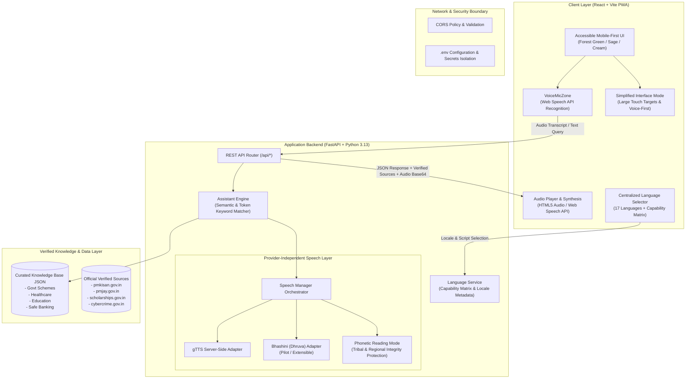
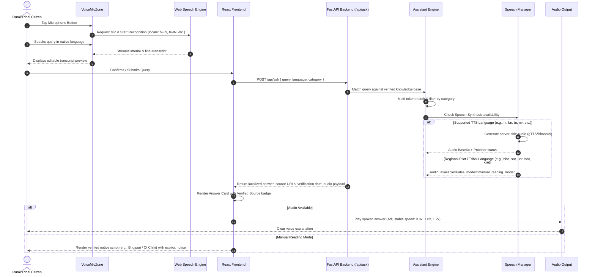

# SwarSahayak (स्वर सहायक) — System Architecture

**SwarSahayak** is a multilingual, voice-first digital assistant architected specifically for rural and tribal citizens of India. It bridges the digital literacy divide by allowing users to interact naturally in their mother tongue through spoken voice or native script, returning verified public welfare, healthcare, education, and safe banking information.

---

## 1. High-Level Architectural Diagram

---

## 2. Sequence Diagram: Voice Question & Answer Lifecycle

---

## 3. Provider-Independent Speech Architecture

The speech layer is decoupled using an abstract interface (`BaseSpeechProvider`). This guarantees that:
1. The frontend never couples directly to a specific commercial speech vendor.
2. The system seamlessly runs out-of-the-box on Windows laptops using free local adapters (`gTTS` + Browser Web Speech API) with zero mandatory paid API keys.
3. When Bhashini API keys (`BHASHINI_API_KEY`, `BHASHINI_USER_ID`) are placed into `.env`, the system automatically switches to Bhashini without changing frontend code.
4. **Phonetic & Linguistic Truthfulness**: If an engine cannot reliably speak a tribal or regional language (e.g., Bhojpuri, Santali, Mundari, Ho, Kui), the engine *never* falsely attempts English or Hindi phonetic approximations. For Bhojpuri, speech synthesis and recognition are disabled rather than substituting Hindi, protecting native phrasing and grammar until authenticated models are tested with native speakers. It explicitly switches to verified reading mode.

---

## 4. Security & Privacy Architecture

- **Zero Credential Collection**: No user authentication, Aadhaar number, banking password, ATM PIN, or OTP is ever requested or accepted.
- **No Raw Voice Retention**: Microphone audio streams are processed in memory and discarded immediately upon transcription. No biometric voiceprints are retained.
- **Source Verification**: All welfare data is linked to authoritative government portals with verification timestamps.
